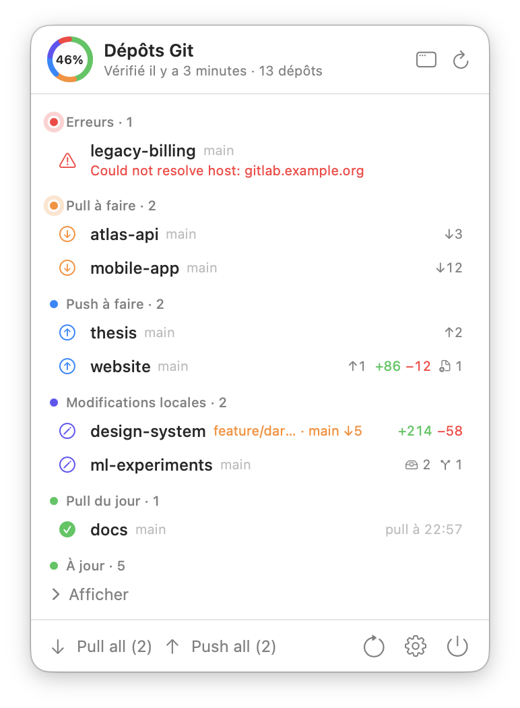
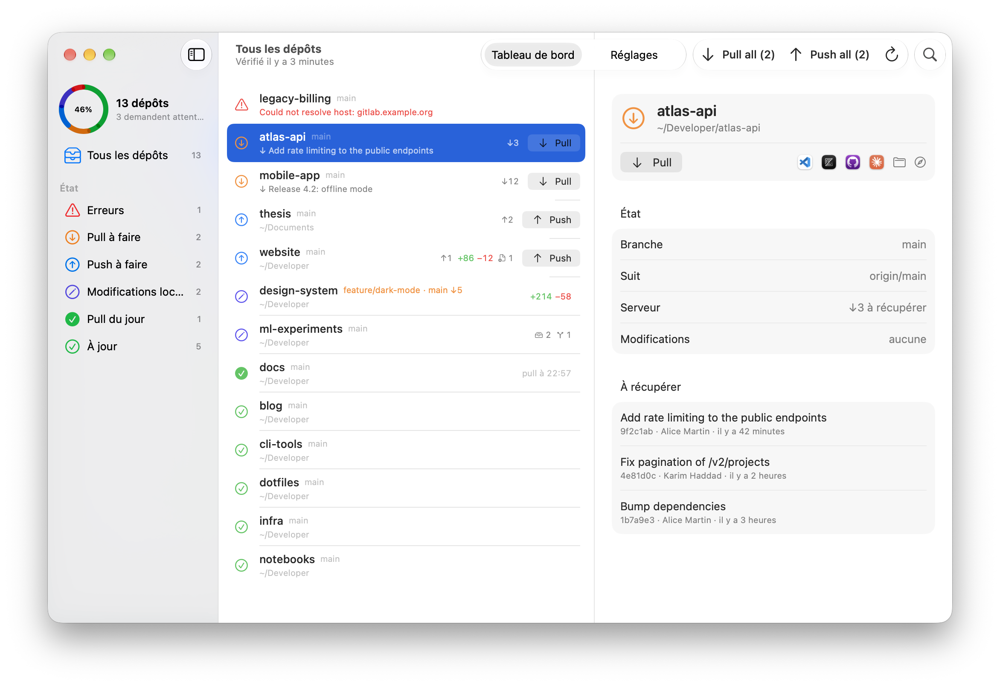
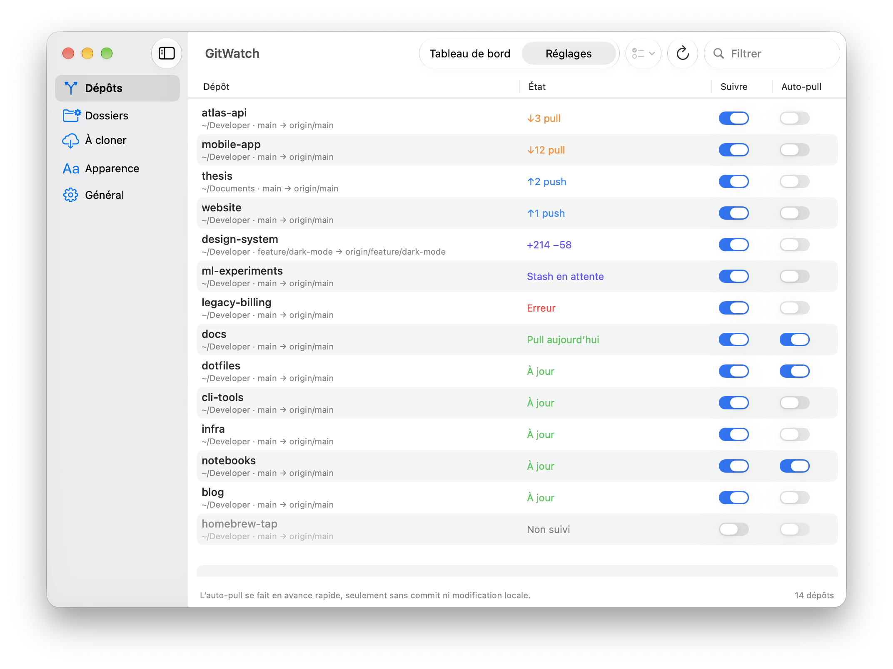
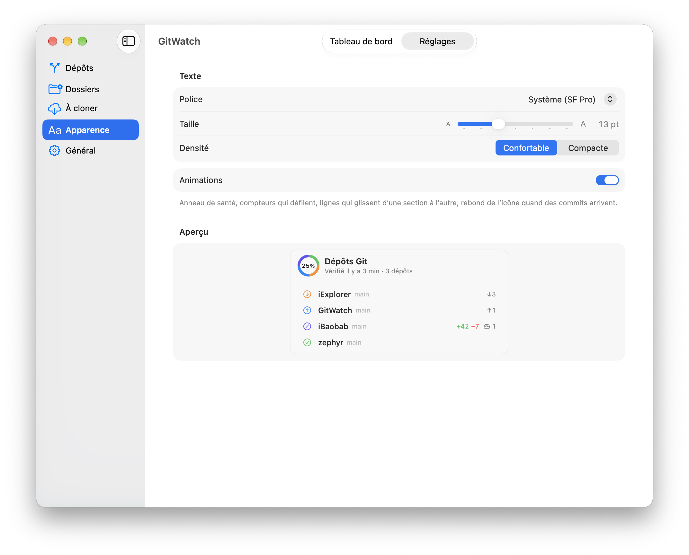
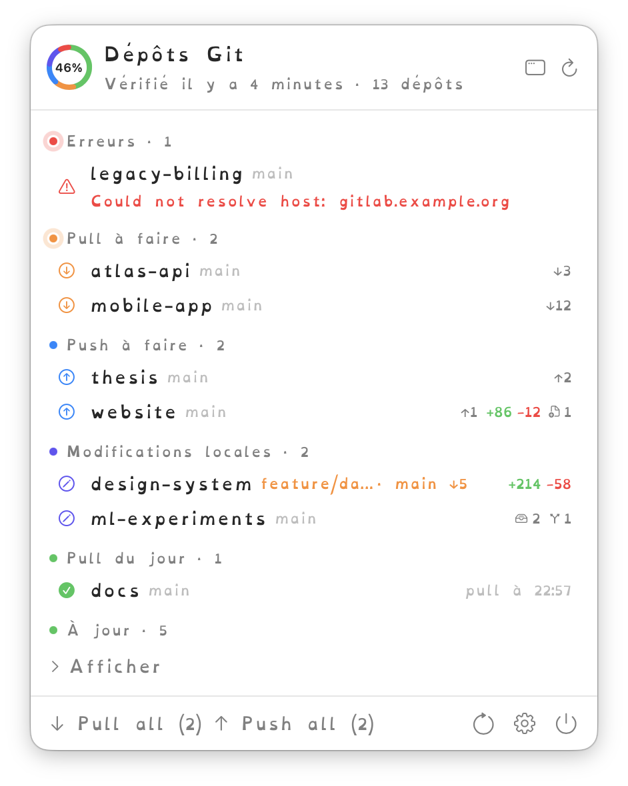
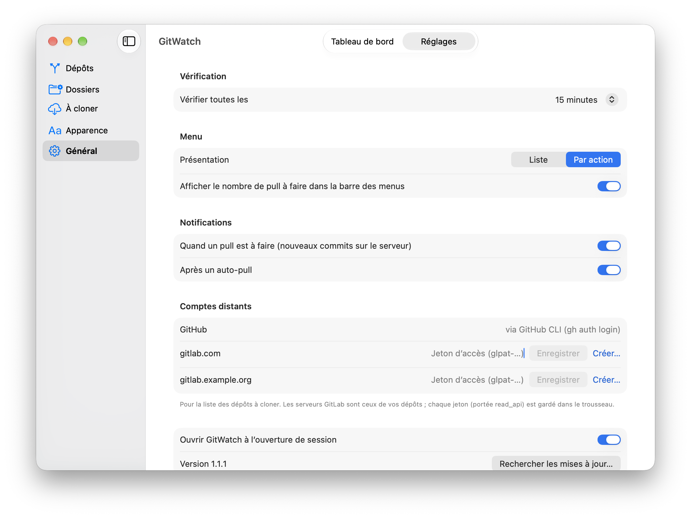

<p align="right"><a href="README.md">English</a> · <b>Français</b></p>

# GitWatch

**Tous vos dépôts Git d'un coup d'œil, depuis la barre des menus de macOS.**

GitWatch surveille tous les dépôts de votre Mac et vous signale ce qui demande votre attention : commits à récupérer, commits à pousser, modifications non commitées, stashes oubliés, branches jamais poussées, serveurs qui ne répondent plus. Il peut aussi faire les pull à votre place, sans risque.

<p align="center">
  <picture>
    <source media="(prefers-color-scheme: dark)" srcset="docs/images/menu-dark.png">
    
  </picture>
</p>

> Les captures montrent des dépôts fictifs.

## Pourquoi GitWatch ?

Quand on travaille sur plusieurs machines, sur plusieurs projets ou en équipe, il arrive :

- de commencer à travailler sur une copie en retard, puis de devoir fusionner ;
- de laisser sur un portable des commits jamais poussés ;
- d'oublier un stash, ou une branche qui n'existe qu'en local ;
- de découvrir des jours plus tard qu'un dépôt n'arrivait plus à joindre son serveur.

GitWatch vérifie tous vos dépôts en arrière-plan (`git fetch`) et vous prévient dès qu'il y a quelque chose à faire. Les dépôts à jour restent discrets.

## Fonctionnalités

- **Découverte automatique** : indiquez vos dossiers (`~/GitHub`, `~/Developer`…), GitWatch trouve les dépôts qu'ils contiennent.
- **Vérification en arrière-plan** toutes les 5 min à 4 h, ainsi qu'au réveil du Mac et au retour du réseau.
- **État clair de chaque dépôt** : commits en retard (↓) et en avance (↑), fichiers et lignes modifiés (+/−), fichiers non suivis, stashes, branches non poussées, branche courante différente de la branche par défaut.
- **Actions en un clic** : Pull, Push, *Pull all*, *Push all*. Les pull se font uniquement en avance rapide : GitWatch ne crée jamais de fusion et ne touche jamais un dépôt qui a des modifications locales.
- **Auto-pull sûr**, dépôt par dépôt.
- **Notifications** quand des commits arrivent, ou après un auto-pull.
- **Ouverture dans vos outils** : VS Code, Zed, GitHub Desktop, Claude Code, Finder, Terminal, ou la page web du dépôt (GitHub, GitLab). Seuls les outils installés apparaissent.
- **Dépôts à cloner** : la liste des dépôts de vos comptes GitHub et GitLab qui ne sont pas encore sur ce Mac.
- **Apparence accessible** : police (dont OpenDyslexic), taille, densité, mode clair et sombre, animations qui respectent « Réduire les animations ».
- **Léger** : application Swift native, sans icône dans le Dock, 0 % de CPU entre deux vérifications, environ 25 Mo de mémoire.

## Captures d'écran

### Tableau de bord

Tous les dépôts dans une fenêtre, filtrés par état, avec les commits à récupérer du dépôt sélectionné.

<picture>
  <source media="(prefers-color-scheme: dark)" srcset="docs/images/dashboard-dark.png">
  
</picture>

### Choisir ce qui est surveillé

Suivez ou ignorez chaque dépôt, et activez l'auto-pull là où il a du sens.

<picture>
  <source media="(prefers-color-scheme: dark)" srcset="docs/images/settings-repos-dark.png">
  
</picture>

### Apparence

Police, taille et densité, avec un aperçu en direct. OpenDyslexic est fournie pour les lecteurs dyslexiques.

<table>
  <tr>
    <td width="62%">
      <picture>
        <source media="(prefers-color-scheme: dark)" srcset="docs/images/settings-appearance-dark.png">
        
      </picture>
    </td>
    <td width="38%">
      
    </td>
  </tr>
</table>

### Réglages généraux

Intervalle de vérification, présentation du menu, notifications, comptes GitHub et GitLab, ouverture à l'ouverture de session, mises à jour.

<picture>
  <source media="(prefers-color-scheme: dark)" srcset="docs/images/settings-general-dark.png">
  
</picture>

## Installation

1. Téléchargez `GitWatch-<version>.dmg` depuis la [dernière release](https://github.com/blegal/GitWatch/releases/latest).
2. Ouvrez-le et glissez **GitWatch** dans **Applications**.
3. L'application n'est pas notarisée par Apple. Au premier lancement, ouvrez **Réglages Système › Confidentialité et sécurité** et cliquez sur **Ouvrir quand même**.

GitWatch apparaît alors dans la barre des menus. Il se met à jour tout seul : les nouvelles versions sont proposées au lancement, ou avec *Rechercher les mises à jour…* dans les réglages. Chaque mise à jour est vérifiée par une signature Ed25519 avant d'être installée.

Nécessite macOS 26 ou plus récent.

## Fonctionnement

- **Découverte** : les dossiers choisis dans les réglages (par défaut `~/GitHub`, profondeur 2) sont explorés à la recherche de dépôts. On ne descend pas dans un dépôt (sous-modules ignorés), ni dans `node_modules`, `Library`, `build`, `DerivedData`.
- **Vérification** : `git fetch --prune` sur chaque dépôt suivi (6 en parallèle), puis `git status --porcelain=v2 --branch` et un seul `git for-each-ref` pour les branches et les stashes.
- **Identifiants** : ceux du système (clés SSH, agent, trousseau). Git ne demande jamais rien de façon interactive (`GIT_TERMINAL_PROMPT=0`, SSH en `BatchMode`) : un dépôt inaccessible apparaît simplement en erreur.
- **Auto-pull** : uniquement en avance rapide (`git merge --ff-only @{upstream}`), et seulement sans commit local ni modification en cours. Sinon le dépôt est juste signalé « Pull à faire ».
- **Push** : `git push`, refusé par le serveur s'il a des commits plus récents.
- **Fusions manuelles** : pour un dépôt divergé, GitWatch propose d'ouvrir GitHub Desktop.
- **Comptes distants** : GitHub via GitHub CLI (`gh auth login`) ; GitLab via un jeton personnel (portée `read_api`) par serveur, gardé dans le trousseau.

Le détail du travail sur le CPU et la mémoire : [docs/Performance.md](docs/Performance.md).

## Compiler

```bash
./build.sh            # produit build/GitWatch.app
open build/GitWatch.app
```

Nécessite Xcode (Swift 6). Variables facultatives : `UNIVERSAL=1` (Apple Silicon + Intel), `VERSION`, `BUILD_NUMBER`, `SIGN_IDENTITY`. Seule dépendance : UpdateKit, du dépôt [iBaobab](https://github.com/blegal/iBaobab), pour la mise à jour automatique.

Le workflow `.github/workflows/release.yml` compile un binaire universel et une image disque signée à chaque push, et publie une release GitHub pour chaque tag `v*`.

- `Tools/bump-version.sh` : incrémente la version avant un commit.
- `Tools/make-icon.sh` : régénère `Resources/AppIcon.icns`.

## Crédits

Police [OpenDyslexic](https://opendyslexic.org) d'Abbie Gonzalez, sous licence SIL Open Font License 1.1 (`Resources/Fonts/OFL.txt`).

## Développement

GitWatch a été développé avec l'aide de [Claude Code](https://claude.com/claude-code), l'assistant de programmation d'Anthropic.
