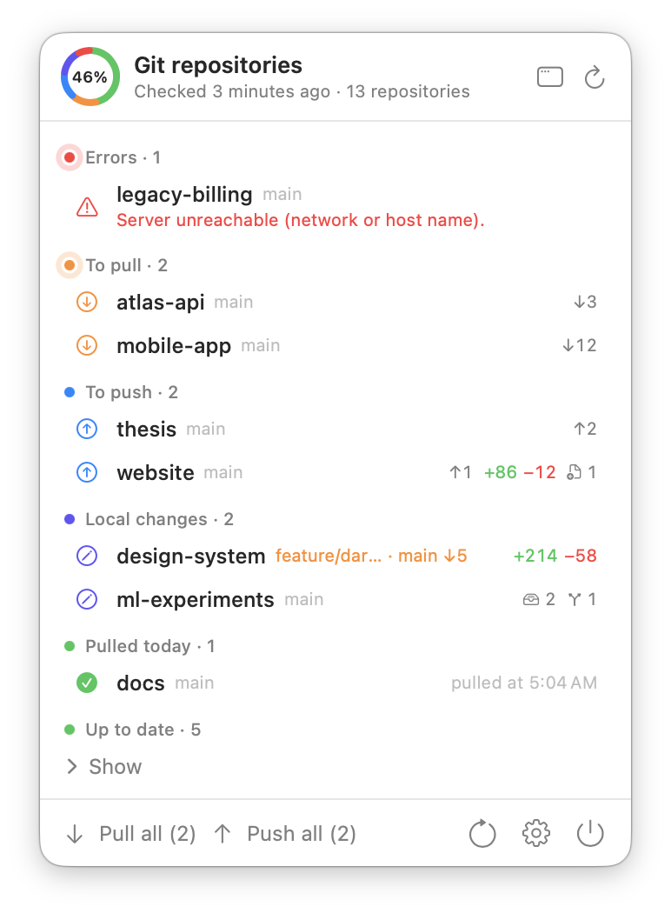
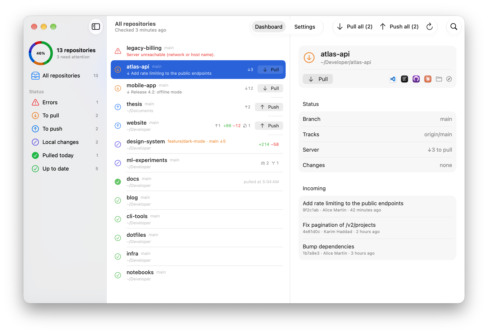
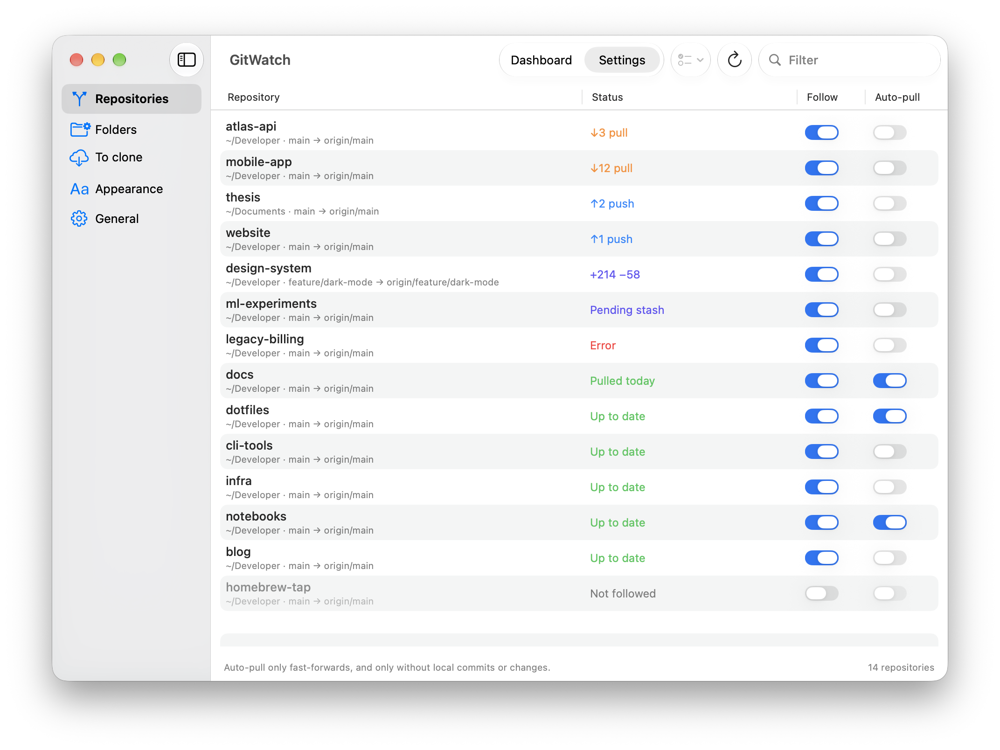
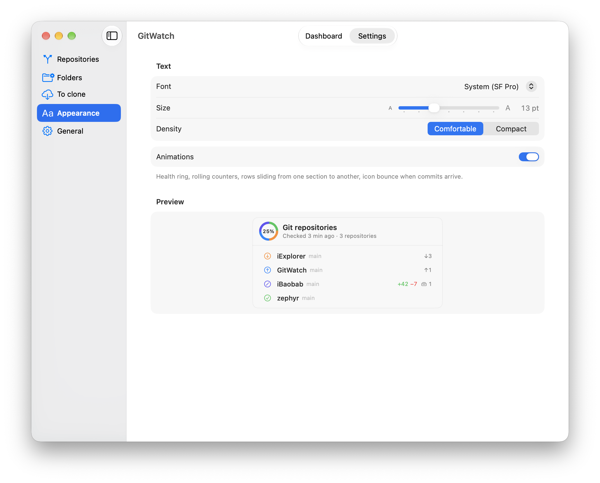
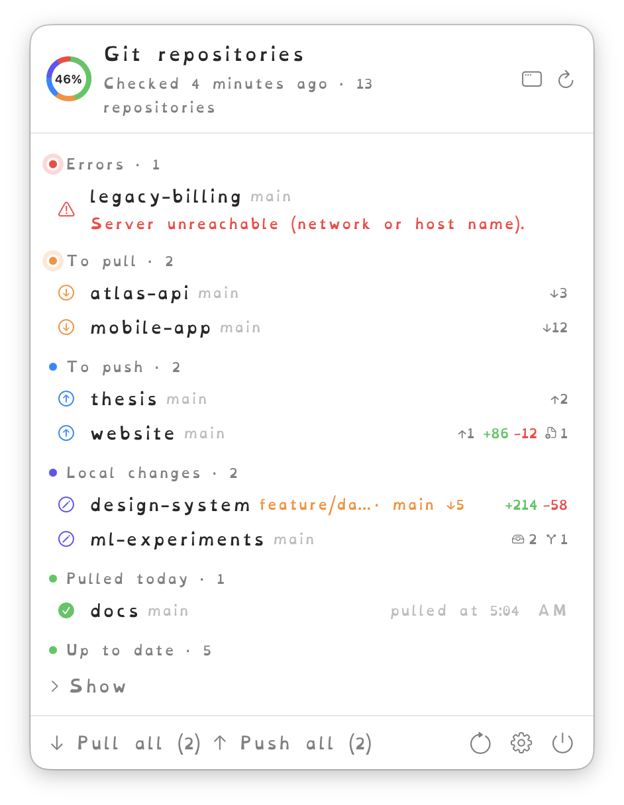
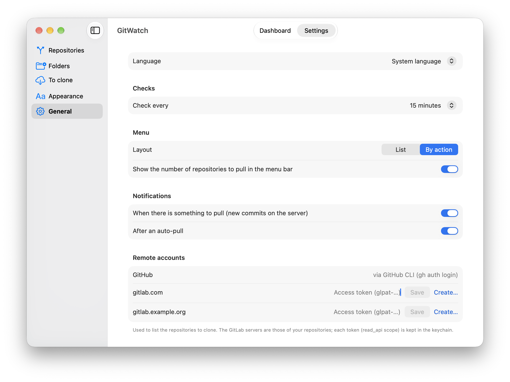

<p align="right"><b>English</b> · <a href="README.fr.md">Français</a></p>

# GitWatch

**All your Git repositories, at a glance, from the macOS menu bar.**

GitWatch watches every repository on your Mac and tells you what needs your attention: commits to pull, commits to push, uncommitted changes, forgotten stashes, branches never pushed, servers that no longer answer. It can also pull for you, safely.

<p align="center">
  <picture>
    <source media="(prefers-color-scheme: dark)" srcset="docs/images/menu-dark.png">
    
  </picture>
</p>

> The screenshots show fictional repositories.

## Why GitWatch?

If you work on several machines, with several projects or in a team, you have probably:

- started working on an outdated copy, then had to merge;
- left commits on a laptop that were never pushed;
- forgotten a stash, or a branch that only exists locally;
- noticed days later that a repository could no longer reach its server.

GitWatch checks all your repositories in the background (`git fetch`) and tells you as soon as something needs doing. Repositories that are up to date stay out of the way.

## Features

- **Automatic discovery**: point GitWatch at your folders (`~/GitHub`, `~/Developer`…), it finds the repositories inside.
- **Background checks** every 5 min to 4 h, plus on wake and when the network comes back.
- **Clear status per repository**: commits behind (↓) and ahead (↑), changed files and lines (+/−), untracked files, stashes, unpushed branches, current branch different from the default branch.
- **One-click actions**: Pull, Push, *Pull all*, *Push all*. Pulls are fast-forward only: GitWatch never creates a merge and never touches a repository with local changes.
- **Safe auto-pull**, repository by repository.
- **Notifications** when commits arrive, or after an auto-pull.
- **Open in your tools**: VS Code, Zed, GitHub Desktop, Claude Code, Finder, Terminal, or the repository web page (GitHub, GitLab). Only installed tools are shown.
- **Repositories to clone**: lists the repositories of your GitHub and GitLab accounts that are not on this Mac yet.
- **Accessible appearance**: font (including OpenDyslexic), size, density, light and dark mode, animations that respect *Reduce motion*.
- **English and French**: GitWatch follows the system language (French if macOS is in French, English otherwise); you can also choose it in Settings › General.
- **Light**: native Swift app, no Dock icon, 0% CPU between checks, about 25 MB of memory.

## Screenshots

### Dashboard

All repositories in one window, filtered by state, with the incoming commits of the selected repository.

<picture>
  <source media="(prefers-color-scheme: dark)" srcset="docs/images/dashboard-dark.png">
  
</picture>

### Choose what to watch

Follow or ignore each repository, and enable auto-pull where it makes sense.

<picture>
  <source media="(prefers-color-scheme: dark)" srcset="docs/images/settings-repos-dark.png">
  
</picture>

### Appearance

Font, size and density, with a live preview. OpenDyslexic is included for dyslexic readers.

<table>
  <tr>
    <td width="62%">
      <picture>
        <source media="(prefers-color-scheme: dark)" srcset="docs/images/settings-appearance-dark.png">
        
      </picture>
    </td>
    <td width="38%">
      
    </td>
  </tr>
</table>

### General settings

Language, check interval, menu layout, notifications, GitHub and GitLab accounts, launch at login, updates.

<picture>
  <source media="(prefers-color-scheme: dark)" srcset="docs/images/settings-general-dark.png">
  
</picture>

## Installation

1. Download `GitWatch-<version>.dmg` from the [latest release](https://github.com/blegal/GitWatch/releases/latest).
2. Open it and drag **GitWatch** into **Applications**.
3. The app is not notarized by Apple. On first launch, open **System Settings › Privacy & Security** and click **Open Anyway**.

GitWatch then appears in the menu bar. It updates itself: new versions are offered at launch, or with *Check for updates…* in the settings. Each update is verified with an Ed25519 signature before it is installed.

Requires macOS 26 or later.

## How it works

- **Discovery**: the folders chosen in the settings (by default `~/GitHub`, depth 2) are searched for repositories. GitWatch does not go inside a repository (submodules are ignored), nor into `node_modules`, `Library`, `build` or `DerivedData`.
- **Checks**: `git fetch --prune` on each followed repository (6 at a time), then `git status --porcelain=v2 --branch` and a single `git for-each-ref` for the branches and stashes.
- **Credentials**: those of your system (SSH keys, agent, keychain). Git never asks anything interactively (`GIT_TERMINAL_PROMPT=0`, SSH in `BatchMode`): an unreachable repository is simply shown as an error.
- **Auto-pull**: fast-forward only (`git merge --ff-only @{upstream}`), and only when the repository has no local commit and no change in progress. Otherwise it is just flagged “to pull”.
- **Push**: `git push`, refused by the server if it has newer commits.
- **Manual merges**: for a diverged repository, GitWatch offers to open GitHub Desktop.
- **Remote accounts**: GitHub through GitHub CLI (`gh auth login`); GitLab through a personal access token (scope `read_api`) per server, stored in the keychain.

Details of the CPU and memory work: [docs/Performance.md](docs/Performance.md) (in French).

## Building from source

```bash
./build.sh            # produces build/GitWatch.app
open build/GitWatch.app
```

Requires Xcode (Swift 6). Optional variables: `UNIVERSAL=1` (Apple Silicon + Intel), `VERSION`, `BUILD_NUMBER`, `SIGN_IDENTITY`. The only dependency is UpdateKit, from the [iBaobab](https://github.com/blegal/iBaobab) repository, for automatic updates.

The `.github/workflows/release.yml` workflow builds a universal binary and a signed DMG on each push, and publishes a GitHub release for each `v*` tag.

- `Tools/bump-version.sh`: bumps the version before a commit.
- `Tools/make-icon.sh`: regenerates `Resources/AppIcon.icns`.
- `Tools/l10n.py build`: regenerates `Resources/en.lproj/Localizable.strings` from `Tools/l10n/en.json` (the code is written in French; `Tools/l10n.py missing en` lists untranslated texts).

## Credits

[OpenDyslexic](https://opendyslexic.org) font by Abbie Gonzalez, under the SIL Open Font License 1.1 (`Resources/Fonts/OFL.txt`).

## Development

GitWatch was developed with the help of [Claude Code](https://claude.com/claude-code), Anthropic's coding assistant.
